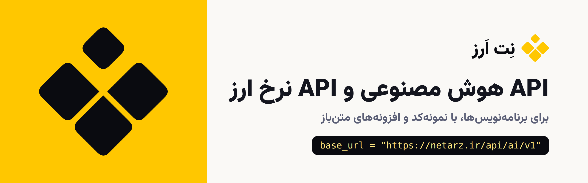

<div align="center">

<a href="https://netarz.ir/open-source?utm_source=github&utm_medium=referral&utm_campaign=netarz&utm_content=header"></a>

**خرید سرویس‌های خارجی با تومان.** «نِت اَرز» مرکز خرید سرویس‌های خارجی برای کاربران ایرانی است.
برای برنامه‌نویس‌ها دو وب‌سرویس داریم: API هوش مصنوعی سازگار با OpenAI و API نرخ ارز به تومان.

NetArz developer APIs: an OpenAI-compatible AI API (GPT, Claude, Gemini, DeepSeek) and a Toman exchange rate API.

[](https://netarz.ir/?utm_source=github&utm_medium=referral&utm_campaign=netarz&utm_content=header)
[](https://netarz.ir/docs?utm_source=github&utm_medium=referral&utm_campaign=netarz&utm_content=header)
[](https://netarz.ir/open-source?utm_source=github&utm_medium=referral&utm_campaign=netarz&utm_content=header)
[](https://netarz.ir/ai-api?utm_source=github&utm_medium=referral&utm_campaign=netarz&utm_content=header)

</div>

<a id="ai-api"></a>

## وب‌سرویس هوش مصنوعی (API هوش مصنوعی)

یک نشانی سازگار با OpenAI، یک کلید، و مدل‌های GPT، Claude، Gemini و DeepSeek. اعتبار را به تومان می‌خرید و هزینهٔ هر
درخواست به دلار از همان اعتبار کم می‌شود. کد نوشته‌شده برای OpenAI با عوض کردن نشانی پایه و کلید کار می‌کند.

```python
from openai import OpenAI

client = OpenAI(base_url="https://netarz.ir/api/ai/v1", api_key="sk-ntz-v1-...")
r = client.chat.completions.create(model="gpt-4o-mini", messages=[{"role": "user", "content": "سلام"}], max_tokens=200)
print(r.choices[0].message.content)
```

[معرفی و قیمت](https://netarz.ir/ai-api?utm_source=github&utm_medium=referral&utm_campaign=netarz&utm_content=ai-api) · [فهرست مدل‌ها](https://netarz.ir/ai-api/models?utm_source=github&utm_medium=referral&utm_campaign=netarz&utm_content=ai-api) · [مستندات](https://netarz.ir/docs/ai?utm_source=github&utm_medium=referral&utm_campaign=netarz&utm_content=ai-api) ·
[OpenAI](https://netarz.ir/ai-api/openai?utm_source=github&utm_medium=referral&utm_campaign=netarz&utm_content=ai-api) · [Claude](https://netarz.ir/ai-api/claude?utm_source=github&utm_medium=referral&utm_campaign=netarz&utm_content=ai-api) · [Gemini](https://netarz.ir/ai-api/gemini?utm_source=github&utm_medium=referral&utm_campaign=netarz&utm_content=ai-api) · [DeepSeek](https://netarz.ir/ai-api/deepseek?utm_source=github&utm_medium=referral&utm_campaign=netarz&utm_content=ai-api) ·
[نمونه‌کدها](https://github.com/netarz/ai-api-examples)

<a id="fx-api"></a>

## وب‌سرویس نرخ ارز (API نرخ ارز)

نرخ دلار و ارزهای دیگر به تومان برای سایت، اپ و صفحه‌گسترده. طرح رایگان فقط عضویت می‌خواهد و نرخ را با کمی تأخیر
می‌دهد؛ طرح پرو نرخ زنده، تاریخچه و هشدار قیمت دارد. هر کلید فقط از دامنه و IPهایی کار می‌کند که خودتان ثبت کرده‌اید.

```bash
curl -4 "https://netarz.ir/api/fx/v1/rates?codes=USD,EUR,AED" -H "Authorization: Bearer $NETARZ_FX_KEY"
```

[معرفی](https://netarz.ir/fx-api?utm_source=github&utm_medium=referral&utm_campaign=netarz&utm_content=fx-api) · [تابلوی نرخ ارز](https://netarz.ir/rates?utm_source=github&utm_medium=referral&utm_campaign=netarz&utm_content=fx-api) · [مستندات](https://netarz.ir/docs/fx?utm_source=github&utm_medium=referral&utm_campaign=netarz&utm_content=fx-api) ·
[نمونه‌کدها](https://github.com/netarz/fx-api-examples) · [افزونهٔ وردپرس](https://github.com/netarz/netarz-fx-wordpress)

<a id="repos"></a>

## مخزن‌ها

| مخزن | چیست | زبان‌ها |
|---|---|---|
| [ai-api-examples](https://github.com/netarz/ai-api-examples) | نمونه‌کد API هوش مصنوعی: استریم، JSON، ابزارها (tools)، امبدینگ، تصویر و صوت، LangChain، ربات تلگرام، n8n، Cursor و Cline | Python، Node.js، PHP، Laravel، cURL |
| [fx-api-examples](https://github.com/netarz/fx-api-examples) | نمونه‌کد API نرخ ارز، به‌علاوهٔ راهنمای قفل IP برای سرورهای بدون IP ثابت | PHP، JavaScript، Python، Laravel، Google Sheets، Excel |
| [netarz-fx-wordpress](https://github.com/netarz/netarz-fx-wordpress) | افزونهٔ وردپرس نرخ ارز با شورت‌کد `[netarz_rate currency="usd"]` و ابزارک | PHP (وردپرس) |
| [netarz-ai-wordpress](https://github.com/netarz/netarz-ai-wordpress) | افزونهٔ هوش مصنوعی وردپرس: چت پشتیبانی هوشمند با سپردن گفت‌وگو به همکار، تیکتینگ و ابزار نوشتن ([معرفی](https://netarz.ir/ai-api/wordpress?utm_source=github&utm_medium=referral&utm_campaign=netarz&utm_content=repos)) | PHP (وردپرس، ووکامرس) |
| [netarz-ai-whmcs](https://github.com/netarz/netarz-ai-whmcs) | افزونهٔ هوش مصنوعی WHMCS: چت آنلاین و پاسخ تیکت با هوش مصنوعی داخل WHMCS ([معرفی](https://netarz.ir/ai-api/whmcs?utm_source=github&utm_medium=referral&utm_campaign=netarz&utm_content=repos)) | PHP (WHMCS) |

همهٔ پروژه‌های متن‌باز ما با توضیح کامل: [netarz.ir/open-source](https://netarz.ir/open-source?utm_source=github&utm_medium=referral&utm_campaign=netarz&utm_content=repos) ·
همهٔ مستندات فنی: [netarz.ir/docs](https://netarz.ir/docs?utm_source=github&utm_medium=referral&utm_campaign=netarz&utm_content=repos)

<a id="contact"></a>

## تماس

- **اشکال در کد:** در بخش Issues همان مخزن بنویسید. Pull Request هم می‌پذیریم.
- **حساب، اعتبار و کلید:** از پنل نِت اَرز [تیکت بزنید](https://netarz.ir/tickets?utm_source=github&utm_medium=referral&utm_campaign=netarz&utm_content=contact) یا به `info@netarz.ir` ایمیل بفرستید.
- **مشکل امنیتی:** فقط به `dev@netarz.ir`، نه در Issue عمومی.

«نِت اَرز» مرکز خرید سرویس‌های خارجی است و نمایندهٔ رسمی هیچ‌یک از شرکت‌هایی که نامشان در این مخزن‌ها آمده نیست.

---

<a id="english"></a>

## English

**NetArz** buys foreign digital services for customers in Iran, paid in Toman. For developers we run two APIs:

- **AI API**: an OpenAI-compatible gateway at `https://netarz.ir/api/ai/v1`. One key for GPT, Claude (via OpenRouter),
  Gemini and DeepSeek models; prepaid credit bought in Toman. [Overview](https://netarz.ir/ai-api?utm_source=github&utm_medium=referral&utm_campaign=netarz&utm_content=english) ·
  [Docs](https://netarz.ir/docs/ai?utm_source=github&utm_medium=referral&utm_campaign=netarz&utm_content=english) · [Models](https://netarz.ir/ai-api/models?utm_source=github&utm_medium=referral&utm_campaign=netarz&utm_content=english) · [Examples](https://github.com/netarz/ai-api-examples)
- **FX API**: exchange rates in Iranian Toman at `https://netarz.ir/api/fx/v1`, domain- and IP-locked keys,
  a free plan with delayed rates and a Pro plan with live rates and history. [Overview](https://netarz.ir/fx-api?utm_source=github&utm_medium=referral&utm_campaign=netarz&utm_content=english) ·
  [Docs](https://netarz.ir/docs/fx?utm_source=github&utm_medium=referral&utm_campaign=netarz&utm_content=english) · [Examples](https://github.com/netarz/fx-api-examples) ·
  [WordPress plugin](https://github.com/netarz/netarz-fx-wordpress)
- **Plugins on the AI API**: [netarz-ai-wordpress](https://github.com/netarz/netarz-ai-wordpress) (AI support chat with human handoff, tickets and writing tools for WordPress/WooCommerce) and
  [netarz-ai-whmcs](https://github.com/netarz/netarz-ai-whmcs) (AI live chat and AI ticket replies inside WHMCS).

All open-source projects: [netarz.ir/open-source](https://netarz.ir/open-source?utm_source=github&utm_medium=referral&utm_campaign=netarz&utm_content=english) · All docs: [netarz.ir/docs](https://netarz.ir/docs?utm_source=github&utm_medium=referral&utm_campaign=netarz&utm_content=english) ·
Security reports: `dev@netarz.ir`

NetArz is an independent store for foreign digital services, not an official partner of the companies named in these repositories.
